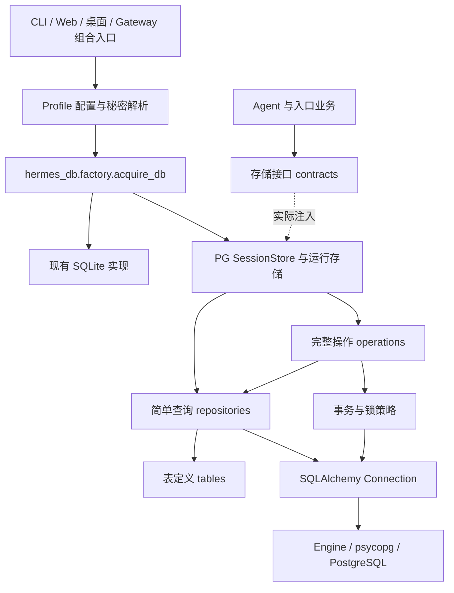

# PostgreSQL 数据库层的代码组织与调用设计

## 状态与范围

> 当前定位：本文件保留会话阶段的历史布局。统一后端已按新设计实施至全领域单后端强验收；发行验证和最终审查以[统一实施计划](../plans/unified-database-backends-plan.md)中的最新状态为准。全局配置及领域边界以[统一数据库后端设计](unified-database-backends.md)为准；下文旧pending/尚未实施描述仅为最初设计时点。

当前实际布局与开发约束见[数据库后端开发指南](../../website/docs/developer-guide/database-backends.md)及[业务域分包设计](hermes-db-package-layout.md)：`factory`选择已捕获的资源，`domains`维护业务规则和短事务，`integration`组合应用能力，`core`/`backends`提供基础设施，`tables`共享当前metadata。下文为2026-11-06历史设计快照；其中旧内部路径不是当前开发或执行入口，原始证据不作追溯改写。

## 原会话阶段设计快照

- 日期：2026-11-06。
- 状态：DESIGN_READY，代码结构设计已收敛，尚未实施。
- 命名已确定：数据库层包为 `hermes_db`，数据仓储为 `repositories/`；沿用 SQLAlchemy Core 推荐方案。
- 承接 [SQLite 源码调研](sqlite-postgresql-research.md) 与 [接入草案](postgresql-session-storage.md)。
- 本轮只补充设计文档；示例均为拟定接口，不是可直接启用的代码。
- 沿用已确认范围：完整会话、运行账本、API 续接与幂等；不安装或管理 PostgreSQL。
- 已确认：新 PG 库启动，不兼容或迁移旧数据；保留 SQLite 可选运行模式。
- 采用共享 Schema + 稳定 store_id；示例中的 store_id 表示服务端确定的持久化作用域，不等于浏览器传入的 user_id。账号/租户授权映射后续单列。
- 关联 [实施计划](../plans/postgresql-session-storage-plan.md)：全部任务 pending，本轮仍未改业务代码。

## 1. 推荐的落地方式

新增 `hermes_db` 包，集中管理后端选择、连接池、表定义、SQL 查询和完整存储事务。保留现有 Agent 会话调用方式，使用已有 `session_db=` 参数注入会话存储。

命名按职责区分：`hermes_db` 表示整个数据库层，`repositories/` 表示数据仓储，`operations/` 表示完整业务事务，`tables/` 表示 Core 表定义。若后续正式选择完整 ORM，其映射模型放在 `models/`；当前不创建这一目录。工作区文件、附件及对象存储由各自的文件存储能力负责。

推荐 SQLAlchemy Core：用 `Table/Column` 定义表，用 `select/insert/update` 组织 SQL，用 `Engine/Connection` 执行。这里没有 ORM 映射对象和长寿命 ORM Session；业务调用者得到普通记录或现有 dict。

如果最终选择完整 ORM，同样只由 Repository 使用映射模型与短寿命 Session；CLI、Web、Agent 的依赖方向不变。此次优先 Core，是因为 Hermes 现有复杂操作以显式 SQL、条件更新和多表事务为主，尚无需要整体改为对象关系模型的证据。

Core 与 ORM 的连接/事务对应关系见 [SQLAlchemy 官方事务教程](https://docs.sqlalchemy.org/en/20/tutorial/dbapi_transactions.html)。这不是将原 SQL 字符串交给 SQLAlchemy 后就自动兼容 PG。

## 2. 文件放在哪里

以下是目标职责目录。按实际迁移主题逐步添加，不先创建所有空模块或未使用接口。

```text
hermes-agent/
├── hermes_state.py                 # 第一阶段仍为现有 SQLite SessionDB
├── hermes_state_*.py               # 现有 SQLite 实现、维护与恢复
├── hermes_state_registry.py        # 保留 SQLite 文件代次与共享句柄管理
│
├── hermes_db/                     # 新的数据库层包
│   ├── contracts.py               # 业务可见的存储接口，按实际消费者定义
│   ├── scope.py                   # 不可变的存储作用域
│   ├── settings.py                # 已解析配置的数据结构，不在这里读全局环境
│   ├── errors.py                  # 后端无关的业务错误与故障分类
│   ├── factory.py                 # acquire_db：选择 SQLite / PostgreSQL 实现
│   ├── handle.py                  # DatabaseHandle：接口持有与释放
│   ├── engine.py                  # 每进程连接池、复用与应用关闭时释放
│   ├── session_store.py           # PG 会话门面，保留已用业务方法名/返回语义
│   │
│   ├── tables/                    # SQLAlchemy MetaData、表与约束
│   │   ├── metadata.py
│   │   ├── conversations.py        # sessions/messages/prompts/usage
│   │   ├── runtime.py              # admissions/workers/leases/receipts
│   │   ├── gateway.py              # routing/generations/delivery 等
│   │   └── api.py                  # responses/run idempotency 等
│   │
│   ├── repositories/              # 数据仓储：实际 SQL 与行映射
│   │   ├── sessions.py
│   │   ├── messages.py
│   │   ├── runtime.py
│   │   ├── gateway.py
│   │   └── api.py
│   │
│   ├── operations/                # 完整存储操作与事务边界
│   │   ├── sessions.py             # 创建/分支/生命周期等
│   │   ├── messages.py             # 追加/批量追加/重写等
│   │   ├── runtime.py              # 准入/领取/终态/恢复
│   │   ├── compression.py         # 压缩事务、尾部保留与发布
│   │   ├── retirement.py           # 删除、墓碑与终态重放
│   │   └── api.py                  # 响应续接与幂等操作
│   │
│   ├── postgresql/
│   │   ├── transactions.py         # 写事务、锁定次序、冲突分类
│   │   └── search.py               # PG 全文/trigram/CJK 搜索实现
│   │
│   ├── migrations/                # Alembic 显式版本迁移
│   │   ├── env.py
│   │   └── versions/
│   │
│   └── legacy_sqlite.py            # 接入现有 SessionDB 与 SQLite 运行函数
│
├── hermes_cli/db_setup.py          # 拟定：现有 Profile 配置/秘密到工厂的桥接
└── tests/hermes_db/                # 镜像源包：业务契约 + PG 集成测试
```

没有为每张表创建一套 Service/Repository/DAO，也没有增加通用 CRUD 基类。`operations` 中只放确有多步骤规则和事务要求的操作；简单查询由门面直接调用 Repository，避免无意义的转发层。

新包不对搬动的内部模块建立 re-export 兼容壳。第一阶段保留 SQLite 原模块的实际实现；将来真的移动内部符号时，按仓库规则同时更新所有引用与文档。

## 3. 模块怎样依赖



依赖规则：

1. `contracts/scope/errors` 不依赖 SQLAlchemy、Web、Gateway 或 Agent。
2. `tables` 只定义数据库结构，不导入 Repository、配置入口或 Agent，不在 import 时建立连接。
3. Repository 依赖表定义和 SQLAlchemy；显式接收本次操作的 Connection 与作用域，不自行 commit，不自行读取 Profile 配置。
4. Operation 组合 Repository 和事务/锁策略；同一业务操作的所有 SQL 使用同一个 Connection。
5. 会话门面保持简短，复杂行为放对应 Operation；不向现有 `hermes_state.py` 添加 PG 分支。
6. Factory 是知道具体实现的组合位置；普通业务代码不导入 PG 驱动或具体 Repository。
7. `legacy_sqlite.py` 需要构造旧实现时使用调用时导入，避免旧 facade/sibling 导入链形成新循环。
8. `hermes_cli/db_setup.py` 只桥接现有配置与秘密解析；数据库层核心不反向导入 CLI、Gateway 或应用启动对象。

这些是模块导入规则，不要求给每个小类都设计抽象基类。Protocol 只覆盖真实消费接口；247 个方法声明中的 SQLite 修复/维护方法不应全部变成跨后端公共协议。

## 4. 入口如何取得和调用存储

现有 [run_agent.py](../../run_agent.py):272 已有 `session_db=` 注入参数；[agent/agent_init.py](../../agent/agent_init.py):1096 将其保存到 Agent。调用方注入时，Agent 通常不拥有数据库句柄的关闭权，可以沿用这一生命周期。

拟定组合示例：

```python
from hermes_db.factory import acquire_db

# 位于入口的组合/初始化代码；resolved_settings 和 scope 已由服务端解析。
with acquire_db(resolved_settings, scope) as db:
    agent = AIAgent(session_db=db.sessions, **agent_options)
    # 运行 Agent；退出时按现有生命周期先停止 Agent 再释放 db。
```

上层调用保持接近现状：

```python
db.sessions.create_session(session_id, source="web", model=model)
db.sessions.append_message(session_id, role="user", content=text)
history = db.sessions.get_messages(session_id)
```

这里 `db` 是 `DatabaseHandle` 轻量作用域句柄，`db.sessions` 是业务会话接口。它不代表持有一条数据库连接，也不代表一个用户常驻一个服务。现有 `SessionDB` 的业务方法名继续保留，不因包命名变化而改名。

完整工厂接入后，CLI、Web、TUI、ACP 和 Agent 的默认懒打开路径都要使用同一后端选择。显式 SQLite 修复、离线导入源读取等工具仍可以打开 SQLite 文件；普通会话路径不能在 PG 已选定后绕回旧注册表。

## 5. SQLAlchemy 具体怎样调用

### 5.1 Repository 中执行 SQL

以下示例展示查询与归属过滤，不代表最终完整表结构或账号授权模型。

```python
# hermes_db/repositories/sessions.py
from sqlalchemy import select
from hermes_db.tables.conversations import sessions


def get_session(conn, scope, session_id):
    statement = select(sessions).where(
        sessions.c.store_id == scope.store_id,
        sessions.c.id == session_id,
    )
    row = conn.execute(statement).mappings().one_or_none()
    return None if row is None else dict(row)
```

`conn.execute(select/insert/update(...))` 就是 Core 模式下的 SQLAlchemy 调用入口。参数由表达式绑定；返回值在数据层转换为现有调用者需要的 dict/记录，不返回 Connection、Result 或 ORM 实体。

表定义与数据库迁移分开：`hermes_db/tables/` 是当前结构描述，`hermes_db/migrations/versions/` 中的 Alembic revision 是如何把已存在数据库升级到该结构的版本历史。应用普通启动检查版本，不让每个 Pod 自动无序执行 DDL，也不对生产库用 `create_all()` 代替版本迁移。

### 5.2 事务由完整操作拥有

追加消息不是只有一条 INSERT。需要保留现有写入保护、消息身份、计数、显示顺序及触发器承担的规则。拟定操作结构如下：

```python
# hermes_db/operations/messages.py
# 事务接口和辅助函数为设计示意，规则清单需依据现有实现补齐。
def append_message(transactions, repositories, scope, command):
    prepared = prepare_message(command)  # 编码与身份准备在进入事务前完成
    with transactions.write() as conn:
        lock_transcript(conn, scope, command.session_id)
        check_write_guards(conn, scope, command)
        message_id = repositories.messages.insert(conn, scope, prepared)
        repositories.sessions.apply_message_counters(conn, scope, prepared)
        return message_id
```

`transactions.write()` 内部使用 SQLAlchemy 的事务上下文，正常完成提交，异常回滚；PG 锁定和可重试冲突政策另行实现。Repository 中的写入形态例如：

```python
result = conn.execute(
    insert(messages).values(**values).returning(messages.c.id)
)
message_id = result.scalar_one()
```

示例没有声称已解决所有锁和触发器行为；发布前必须把完整操作中的全部规则纳入同一事务或明确的数据库约束。

读操作在短连接范围内执行并完整取出结果后释放。写操作可以用 `Engine.begin()` 等方式界定事务；具体行为见 [SQLAlchemy Engine 与事务文档](https://docs.sqlalchemy.org/en/20/core/connections.html)。模型请求、终端执行和网络投递都在事务外进行，不占用连接等待整轮聊天。

### 5.3 为什么 Repository 不自行提交

如果 `messages.insert()` 自己提交，而计数或回执随后失败，会留下不完整结果。因此 Repository 接收外部 Connection，提交权属于完整 Operation。

也不能在一个 Operation 中调用另一个会自行开启事务的公开会话方法。需要复用时调用接收当前 Connection 的内部函数，确保原子边界不被拆开。

ORM 变体的规则一样：由 Operation 使用 `session_factory.begin()` 建立一次短 Session，Repository 使用该 Session，完成时转成业务记录。ORM Session 不按聊天会话缓存，也不跨并发任务共享，见 [SQLAlchemy Session 生命周期与并发说明](https://docs.sqlalchemy.org/en/20/orm/session_basics.html)。这是备选说明，本建议仍采用 Core。

## 6. 运行账本的调用必须单独接线

当前不仅有 SessionDB 方法。[gateway/session_authority.py](../../gateway/session_authority.py):26、622、1155 还直接调用 `admit_session_input(db, ...)`、`claim_session_input(db, ...)` 等函数，它们内部仍然执行 SQLite SQL。

因此不能把一个 PG SessionStore 传给这些旧函数就算完成适配。拟定把运行持久化调用收敛为：

```python
db.runtime.admit_input(epoch=epoch, session_id=session_id, **request_options)
db.runtime.claim_input(epoch=epoch, session_id=session_id, **claim_options)
db.runtime.settle_input(epoch=epoch, admission_id=admission_id, **result_options)
```

PG 实现进入 `hermes_db/operations/runtime.py`，在同一事务中组合会话、准入、Worker 与墓碑查询；SQLite 实现调用现有对应函数。`db.sessions` 和 `db.runtime` 共用连接资源与作用域，但不会互相调用各自的公开方法来拼事务。

API 响应、Run 幂等和投递账本按相同原则接入，实际迁移消费者时再加入对应接口。不把全部表简单装进一个无边界的 SessionDB，也不漏掉门面之外的 SQL。

受管 compute Worker 继续使用 [agent/runtime_session_store.py](../../agent/runtime_session_store.py) 通过所有者 RPC 提交持久化。该边界用于执行代次和回执控制；本次不会因为接入 PG 就给所有 Worker 发放主库直连权限。

## 7. SQLite 与 PG 如何共存

| 事项 | 第一阶段 SQLite | 第一阶段 PostgreSQL |
| --- | --- | --- |
| 会话存储 | 现有 SessionDB | 新 SQLAlchemy Core 会话门面与操作 |
| 运行操作 | 现有 runtime 函数，由消费接口接入 | 新运行 Operation |
| 资源管理 | 继续由现有文件注册表处理代次、引用与关闭 | Engine 每进程复用，短连接/短事务 |
| 搜索 | 现有 FTS5/CJK | PG 搜索适配 |
| 修复、WAL、文件探测 | 保留本地实现 | 对应 PG 健康与模式检查 |
| 行为验证 | 原行为基准和 SQLite 专属测试 | 同一业务契约及真实 PG 并发/故障测试 |

这意味着第一阶段并非立即让 SQLite 也改走 SQLAlchemy。先保持其已验证实现，再逐步共享真正通用的编解码和查询；是否进一步统一 SQLite 的 SQL 层，要由维护收益和验证证据决定。

Task 15 的 PG 搜索由 `session_search.py` 组合纯 `search_query.py`、`search_projection.py`、`postgresql/search.py` 及 `repositories/search_context.py`。消息的派生 document/短字数组在普通写入时同步，分块 `message_search_chunks` 向量由 Alembic 安装的触发器在原事务中维护，包含直接 SQL 克隆；删除通过 scoped FK 级联。全文使用每块 GIN，短字数组和 pg_trgm 服务候选后复核。GIN 为非唯一派生索引，作用域由查询、主键及 FK 保证，不增加 btree_gin 依赖。启动不创建索引/函数，不改会话 search_path。真实 PG 语义及性能证据见实施计划，未验证部分保持 pending。

Factory 只在打开逻辑存储时选择一次后端，选定 PG 后某方法未完成应显式阻止启用，不能调用一半 PG 再回 SQLite。完整生产切换必须在全部约定能力接通后进行。

Task 16 的显式身份/健康在 `health.py`、`session_health.py`；归档引用由原消息事务写入 `spillover_names`，roster 写入有界 BYTEA `roster_preview`，Alembic `0003_archive_refs` 只回填当前 PG 行。维护选择器在 `repositories/retention.py`，归档/剪枝/孤儿关闭在 `operations/maintenance.py`。Insights/Web 分析使用命名 `repositories/insights.py`、`analytics.py`，不提供 SQL 字符串翻译器。

当前 PG Profile 移动和采用在 `session_profile_moves.py` 与 `operations/profile_move.py`、`adoption.py`，限定同连接目标/共享 Schema、不同 store_id；移动回执和源摘要决定重复导入/删除。`operations/file_grants.py` 与 scoped state_meta 授权保留原物理 home 的文件，目标最后引用消失后撤销授权，由本地 owner 标记匹配的清理器回收；未知归属/引用保持文件，不执行文件迁移。跨 SQLite/PG 修复不复制数据。`session_resource.py` 只管理调用方的 DatabaseHandle 释放，不持有 Connection。原 SQLite 只读读取/本地维护保留，PG 缺文件不代表空库；PG 文件备份明确排除数据库，实例备份/恢复归操作者。Task 17 尚需统一所有普通获取点后才启用工厂。

## 8. 对象生命周期和隔离

| 对象 | 生命周期 | 约束 |
| --- | --- | --- |
| Engine/连接池 | 每个应用进程、连接配置维度复用 | 不每用户/每请求建池；在应用关闭时统一释放 |
| 数据库作用域句柄 DatabaseHandle | 按消费者持有，可被明确拥有它的后台任务使用 | 绑定不可变 scope，不通过修改全局 user/profile 切换身份 |
| Connection/事务 | 一次短数据库操作 | 不跨线程、并发任务或模型调用共享 |
| 返回记录 | 已独立取出的 dict/数据记录 | 不依赖连接仍存活，不触发懒加载 |

不同用户可以复用相同 Engine，但每条查询和完整事务必须带正确的服务器端归属。连接池共享不意味着数据可见性共享。不得用可变全局 `search_path` 或 `os.environ` 作为并发请求切换租户的机制。

## 9. 接入顺序和验收

1. 先确认作用域、接口与已有返回契约，再建配置桥接、工厂及生命周期；不先改变业务行为。
2. 完成会话读写与消息旁路字段；Agent 通过现有注入参数使用新存储。
3. 将 authority 的运行函数调用迁移为运行接口，验证队列、epoch、代次、压缩和删除终态。
4. 接通 API 辅助存储、搜索、归档引用、健康检查及新库 Schema 初始化；不包含历史数据导入。
5. 所有普通入口统一使用工厂，检查隐藏直连与降级路径，再允许完整 PG 后端启用。

代码落位已拆成 [可恢复实施计划](../plans/postgresql-session-storage-plan.md)。两个后端要通过同一业务契约，PG 需真实数据库证明并发和失败语义；只验证 Repository 基础读写不能作为完成依据。

本次文档自检覆盖本地引用存在性、示例定位与源码事实；没有创建上述代码目录，没有增加驱动，没有执行测试或迁移。

## Task 1 实施契约

2026-11-06：已建立 [业务契约与消费者清单](../plans/postgresql-session-storage-contracts.md)。后续表、操作和接线以该清单的作用域键、原子边界、保真编码和方法归属为检查依据。PG 仍未实现或验证。

## Task 17 入口接线检查点

2026-11-07：普通获取/释放落在 `hermes_db/access.py`，Native registry 按进程、连接配置和不可变 scope 共享 store，`SessionResource` 各自持有 acquisition。`runtime_access.py`/`runtime_calls.py` 按后端调用完整运行能力；local、history 和 terminal boundary 使用命名操作及显式 CoreEffect，不转换 SQLite SQL。PG local/API 持久化命名空间采用稳定 store_id，连接目标/Schema 摘要用于资源匹配和移动 guard；公开 Profile 授权协议与本地文件 home 分离。Profile 克隆在发布 staging 前分配新 PG 身份，原 Profile 改名保留稳定身份。

`agent/session_persistence.py` 拥有懒 recall 获取，`hermes_cli/main_session_storage.py` 拥有启动只读 lookup，`gateway/run_session_storage.py` 拥有 runner 借用句柄缓存与关闭。`hermes_db/api_resources.py` 和 `gateway/platforms/api_server_storage_resources.py` 管理 Responses 所属 Profile 的资源；准入重查复用 Responses 当前事务连接。Gateway 通过已有 quiesce 护栏后释放投递 handle、两个 registry 和 PG Engine；单个 Profile unserve 只关闭该 home 的资源。

Task 17 的 `runtime_api.py` / `operations/api_binding.py` 组合当前 API 绑定与准入设置，`runtime_media.py` 组合 scoped 媒体持有/分批终态正文维护。`operations/worker_reservation.py` 实施私有 managed-worker 预留/loss；`worker_access.py` 负责 owner claim 的后端派发。受管 compute 的 recall 通过 `gateway/session_worker_recall.py` 认证只读 RPC，数据库选择与命名 Profile 解析在 owner，读取不消耗写入回执序号，不能由 worker 本地打开 SQLite 代替 PG。API 请求身份控制锁按 store_id+request hash 保存于现有 state_meta，先于会话根锁取得；终态/删除不回收该锁目标。

工厂现已只在显式 PG 配置下获取 Native registry，缺驱动/不可达/错误版本显式失败，不自动执行DDL或回落SQLite。Achievements 扫描器经统一只读获取，派生检查点绑定数据库目标/Schema/store_id资源身份，后台线程继承发起Profile。控制台SQLite维护和旧历史adopt在PG模式提前拒绝。Task17 commit f874e6be49 为离线实现检查点，真实PG和全回归仍未通过。

Task18 发行检查遵守 setup.py 的非Nix wheel/sdist守卫：Windows验证已提交代码导出的独立source-bundle载荷和PM环境，使用隔离解释器从开发源码目录外检查模块和Alembic资源。它不等于Nix/uv2nix构建通过；真实安装模式Schema初始化仍需真实PG。

### Task 17：独立 HostedRoom 协调与 PG 主库边界

协调文件名的摘要包含已规范化的数据库目标、Schema 与 store_id，复用 `resource_key`；用户/口令不参与文件身份。相同本地 home/store_id 改指不同目标或 Schema 时得到独立协调库，凭据轮换保留原协调库。此调整仅收紧独立房间文件的作用域，不改变规范会话命名空间或迁移文件。

现有 canonical room service 在主 SQLite 文件中保存房间所有者/任务，用同一连接在提交会话准入时检查成员与 task generation。PG 主库没有 hosted_room 表；这项共连接假设必须拆开。独立房间数据库继续采用本地 SQLite，PG 模式在 Profile home 中按上述资源身份摘要命名新的 hosted 协调文件；其中只有房间协调表、owner KV 和本地房间运行 epoch，不创建 sessions/messages/session_admissions。SQLite 模式继续使用原文件和事务。PG 新空间不导入旧房间任务，防止旧任务对全新准入账本重复执行；原 SQLite/standalone 数据保持原位。

Native 房间提交先在持久化 worker 线程取得本地协调库的写入栅栏，核对 owner、成员、房间 authority/task generation，再借用 PG 连接提交规范准入。锁顺序固定为本地房间栅栏→PG epoch/映射/根；PG 事务内只检查这次已锁定的房间状态，禁止反向新借 SQLite 锁。房间栅栏保持到 PG 提交结果返回后释放，该桥接上下文本身只读房间数据，不制造跨库双写原子性承诺。PG 的 epoch/CoreEffect 和稳定请求回执继续决定 canonical 接受与重放；本地协调文件的 epoch 在该节点服务准备阶段更新，过期服务拒绝控制。

这属于解除主库依赖的执行调整，独立房间元数据仍依赖本机文件；本轮不增加房间 PG Schema、旧数据导入、跨节点房间协调或独立数据库的多副本保证。后续必须用行为契约验证本地房间授权回滚、PG 提交确认丢失后的同身份查询，以及房间成员/任务变更无法跨过准入栅栏。

此处记录已落位代码，不代表 Task 17 已完成。普通资源获取、Run 路由/恢复、API/Worker CoreEffect 和关停释放已接入，显式 PG 配置由工厂获取 Native 资源；启动仍只检查 Schema，不执行 DDL。当前格式历史续接使用 Native claim，在一个受栅栏保护的事务中提交策略与路由，保留原消息和提示前缀，不调用 SQLite 旧格式采用。状态与最新命令证据以实施计划为准。

### 真实PG验收调整：不解析含正文的JSON做标记查询

PG的JSON/JSONB getter会在无关字段也解码NUL，实际模型stop选项可触发列表、删除和配置键扫描失败。0004增加delegate/branch存在标记及BYTEA委派来源投影，随原model_config在同事务创建/更新，克隆复制、导入重算；0001–0003不改，升级分批回填当前PG数据。原配置仍是完整TEXT JSON。任意配置路径扫描和webhook恢复在当前store分批读原文后Python解析；viewer只读取请求session的policy并在同一读快照查询目标。此调整增加派生列和当前PG revision，不迁移SQLite、不清洗提示/正文，不放宽作用域或执行栅栏。

消息display_metadata的title_preview也可合法含NUL，0004冻结前增加内部display_query JSONB投影。顶层键和值分别序列化为ASCII JSON字符串，JSON null仍为null；SQL比较绑定同算法字符串，保持键、值和类型的区分，不对原metadata做字符替换。中央消息insert/update同步派生，INSERT SELECT保留，decoded_row移除内部列；冻结迁移分批回填，内容摘要排除派生字段。原display_metadata、正文、提示和工具快照保持完整。
