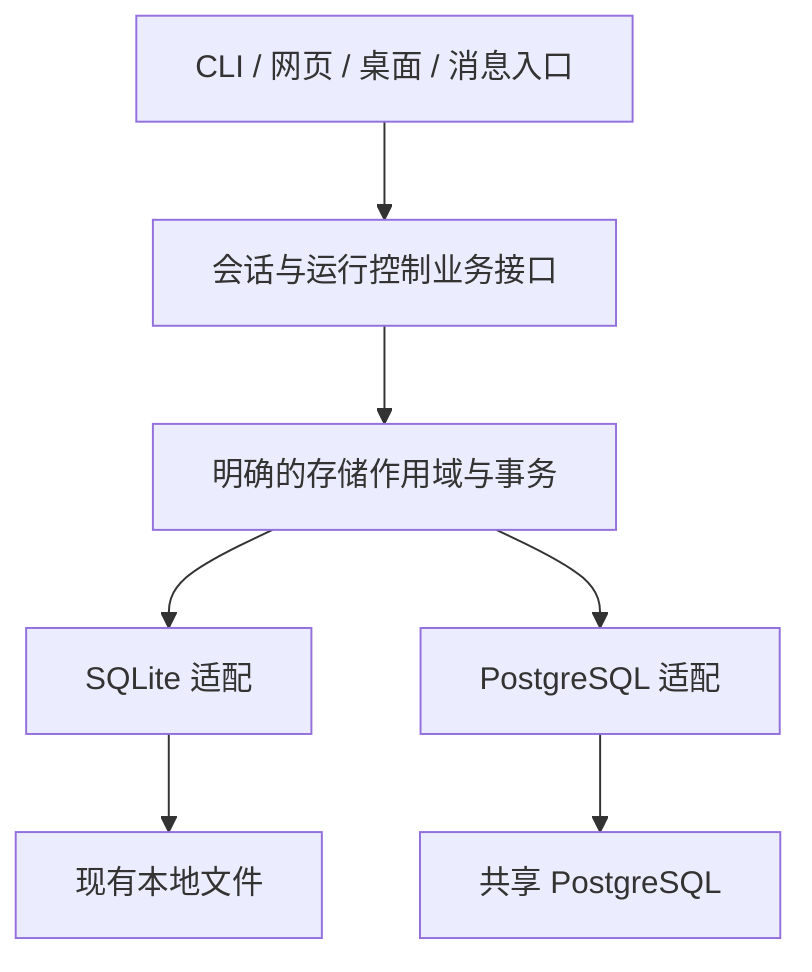

# SQLite 到 PostgreSQL 的源码调研

## 状态与结论

- 日期：2026-11-06。
- 状态：源码调研已完成；实施范围与架构见接入设计和实施计划，尚未运行 PostgreSQL 验证。
- 后续决策：用户已确认只支持新 PG 数据，不兼容或迁移旧数据；数据库层采用 hermes_db、共享 Schema + 稳定 store_id，执行任务见 [实施计划](../plans/postgresql-session-storage-plan.md)。下文源码事实保留，历史导入分析不构成实施范围。
- 本次只做源码、测试和参考项目研究，保存调研文档；没有修改业务代码、依赖或运行配置，没有连接数据库、执行迁移或运行 PostgreSQL 集成测试。
- 目标：为完整会话存储接入 PostgreSQL，保留现有 SQLite 本地模式，为后续共享 Web 服务提供数据基础。
- PostgreSQL 实例由用户管理。本项目负责配置入口、驱动、连接池、Schema 迁移和业务读写适配。

**可以替换，但工作量集中在并发事务和隐含文件依赖。当前没有可直接切换数据库地址的 ORM 层。建议保留业务接口，引入 SQLAlchemy Core、同步 psycopg 和显式迁移，逐步建立两种后端的行为契约。**

完整会话范围至少涉及 `state.db` 的 17 张基础表、同文件按需创建的投递账本，以及两个 API 辅助数据库中的 6 张表。只迁移 `sessions`、`messages` 会留下续接、幂等、压缩、删除和运行恢复的不一致。

**PostgreSQL 接入与运行时自动扩容是两项工作。** 当前运行时以 Profile 所有权和 epoch 防止多个所有者同时执行；共享数据库不会自动把这套机制变为多副本共同消费。

## 1. 调研范围与证据口径

研究了根目录会话模块，以及 `agent/`、`gateway/`、`hermes_cli/`、`tui_gateway/`、`tools/`、`plugins/`、`cron/`、`acp_adapter/`、`providers/`、`pm/`、`hermes_platform/` 中的相关生产 Python 文件；另读相关测试及本地 `dify-main/`。

静态扫描的选定生产范围包含 2,625 个 Python 文件，其中 129 个含有 SQLite 相关文本；根目录 `hermes_state*.py` 共 63 个文件、27,531 行。SessionDB 门面与 18 个 Mixin 中有 247 个公开方法声明。数字包含注释、修复代码和本地专用维护逻辑，**不代表有 129 个文件都要改，也不代表所有方法都需要重写**。

以下区分三种信息：源码事实、由事实推导的迁移风险、推荐但未实现的方案。没有使用生产数据库中的真实数据作验证，性能和 PostgreSQL 并发正确性仍需后续实测。

## 2. 当前的数据访问层

### 2.1 没有 SQL ORM，已有业务门面

| 层次 | 当前实现 | 迁移含义 |
| --- | --- | --- |
| 业务门面 | [hermes_state.py](../../hermes_state.py):464，`SessionDB` 与主题 Mixin | 能复用方法、返回结构和业务规则；不能直接换一个 URL |
| 读写辅助 | 同文件的 `_execute_write`、`_read_ctx`、`_read_one`、`_read_all` | 已有集中事务入口，但参数、异常、连接类型仍绑定 SQLite |
| 实际连接 | [hermes_state_dbfile.py](../../hermes_state_dbfile.py):603 | 原生 `sqlite3.connect`、文件句柄和安全读取 |
| 表与升级 | [hermes_state_common.py](../../hermes_state_common.py):289、452；[hermes_state_schema.py](../../hermes_state_schema.py):940 | 手写 DDL、触发器、版本和打开时修复 |
| 实例共享 | [hermes_state_registry.py](../../hermes_state_registry.py):195 | 注册表以文件路径、文件代次和引用计数管理生命周期 |
| 受管 Agent 读写 | [agent/runtime_session_store.py](../../agent/runtime_session_store.py) | 已有通过运行所有者提交的接口，但不是通用 SQL 后端抽象 |
| 依赖 | [pyproject.toml](../../pyproject.toml) | 未声明 SQLAlchemy、SQLModel、Peewee 或 psycopg 会话后端；`asyncpg` 属于 Linux Matrix 插件依赖 |

`_execute_write` 当前在进程锁下执行 `BEGIN IMMEDIATE`，随后运行回调、提交或回滚，并处理忙锁重试和 SQLite 维护。许多“先查、判断、再改多张表”的业务依赖这里对写操作的串行化。

因此，抽出一个 `connect()` 或给 SQL 字符串加占位符转换都不足以完成替换。事务边界和业务锁定对象必须一起确定。

### 2.2 建议保留的调用关系

业务接口继续负责“准入一个输入”“提交一轮执行”“压缩并保留并发尾部”等完整操作。连接池、方言和行映射放在数据层；不要把这些原子操作拆成上层任意组合的独立 CRUD。

## 3. 需要迁移的数据

### 3.1 `state.db` 的基础表

定义见 [hermes_state_common.py](../../hermes_state_common.py):452–718。这里的分组用于识别职责，不是建议拆成多个数据库。

| 分组 | 表 | 必须保留的意义 |
| --- | --- | --- |
| 模式管理 | `schema_version` | 识别数据结构版本；PG 应有自己的迁移版本体系 |
| 会话正文 | `sessions`、`messages` | 会话身份、谱系、消息、工具调用、推理内容、多模态旁路字段、显示顺序、活动与压缩状态 |
| 提示与计费 | `system_prompts`、`session_model_usage` | 精确提示词快照、哈希、按模型和计费来源累计的用量 |
| 执行准入 | `runtime_epoch`、`session_admissions` | 所有者代次、请求去重、排队、领取、终态和未知执行 |
| Worker | `worker_executions`、`worker_receipts` | 子执行状态、幂等回执和结果提交栅栏 |
| 持久元数据 | `state_meta` | 包含删除墓碑、回执、策略和路由退休信息，不能整体当成缓存丢弃 |
| 路由和整理 | `gateway_routing`、`gateway_hygiene_state` | 入口与目标会话映射、整理进度和状态 |
| 会话代次 | `conversation_generations` | 删除后也不复用旧代次，维持会话和提示缓存身份 |
| 心跳 | `gateway_heartbeats` | 网关存活与恢复判断所需记录 |
| 并发控制 | `compression_locks`、`session_turn_leases` | 压缩与会话回合的互斥、续租及持有者检查 |
| 异步委派 | `async_delegations` | 异步子任务的持久关联和结果状态 |

同一个 `state.db` 还有第 18 张表：`delivery_obligations`，由 [gateway/delivery_ledger.py](../../gateway/delivery_ledger.py):188 创建。它记录对外投递义务、尝试和恢复，必须进入迁移清单，不能只扫描主 Schema 常量。

FTS 虚拟表、影子表和重建状态另行处理：迁移其搜索语义并重建 PG 索引，不复制 SQLite 引擎的物理索引结构。

### 3.2 API 续接与幂等：建议纳入完整会话范围

| 文件 | 表 | 原因 |
| --- | --- | --- |
| `response_store.db` | `responses`、`conversations`、`response_keys`、`response_admissions`、`response_output_order` | 响应续接、请求身份、准入关联及输出顺序 |
| `runs_idempotency.db` | `run_idempotency` | Run 请求指纹、重复请求返回、终态和处理中状态 |

源码：[api_server_response_store.py](../../gateway/platforms/api_server_response_store.py):43–83；[api_server_run_idempotency.py](../../gateway/platforms/api_server_run_idempotency.py):51–88。

两个存储都有失败后退回内存的路径。选定 PG 的服务模式应明确失败，避免请求身份只存在某个 Pod 内存中。

响应存储还会直接打开相邻的 `state.db`，查询准入终态和退休记录，见 `api_server_response_store.py:162`。PG 适配必须通过会话存储查询这一关系；不能保留“根据另一个数据库文件的父目录寻找主库”的做法。

可以让这些表共用 PG 连接目标和作用域；是否将原来跨文件的操作收敛成同一事务，需要按业务要求设计，不能假设原代码已具备跨库原子性。

### 3.3 其他 SQLite：登记依赖，分阶段处理

| 数据 | 当前典型位置 | 本阶段建议 |
| --- | --- | --- |
| Cron 执行、投递、便笺 | `cron/executions.db`、`deliveries.db`、`notepad.db` | 单列后续迁移；相关会话本身仍包含在主库存储中 |
| Kanban、项目 | `kanban.db`、`projects.db` | 独立业务存储，不并入会话模型 |
| Hosted rooms | `shared-state.db` 及附件表 | 若第一版开放此功能，需追加其持久化范围 |
| 验证证据、可观测数据 | `verification_evidence.db` 等 | 根据功能是否启用单独规划 |
| 插件存储 | `plugin-data/<plugin>/data.db`、RetainDB 队列、Matrix 加密等 | 保持插件边界，逐项确定部署支持，不由主会话适配器接管 |
| 平台恢复记录 | Discord 消息恢复等 | 独立检查跨副本协调要求 |
| SQLite 修复产物 | `lost_and_found.db` 等 | 留在 SQLite 诊断与恢复工具中 |
| 用户自己的数据库、浏览器数据库 | `tools/read_extract.py`、浏览器连接相关代码 | 属于工具操作的数据源，继续保留 SQLite 读取能力 |

配置 YAML、`.env`、提示词 Markdown、记忆文件、技能、工作区、工具结果归档不因本次接入自动进入 PG。后续部署仍需给文件存储和执行环境设计明确归属。

## 4. 不能在迁移中丢失的数据语义

| 当前特征 | 替换时的约束 |
| --- | --- |
| 会话 ID 是任意文本，消息主键是 SQLite 自增整数 | 不强制套用 Dify 的 UUID；整数范围按 64 位评估，保留外部可见身份与顺序 |
| 时间戳和费用大量使用 SQLite `REAL` 与 Python 浮点 | 若保留现有表示，PG 使用 `DOUBLE PRECISION`；不要直接映射为 PG 的 32 位 `REAL`。金额改精确小数应作为单独行为变更 |
| 整数 0/1 标志、容错 JSON 文本 | 逐字段确定类型与非法历史值策略，不能直接假设旧值都满足 BOOLEAN 或 JSONB |
| 系统提示词、工具快照、摘要和请求指纹 | 保留原文与既有摘要输入，避免格式化或 JSON 重编码改变身份 |
| 消息具有 `message_uid`、吸收 UID、工具调用 UID、显示身份 BLOB 与显示顺序 | 这些是重写、压缩和显示去重的业务字段，不能只复制 role/content |
| 压缩后旧消息保持 inactive/compacted | 保留归档历史，不能把旧记录重新激活为模型上下文 |
| 模型用量按多维组合累计 | 保留 session/model/provider/base URL/billing mode/task 的组合维度 |
| 删除仍留下终态回执和墓碑 | 删除不是清空所有关联记录；重复请求不得复活旧会话 |
| 路由与世代隔离 | 现有 Profile 岛屿的边界必须显式继承，不能将多个 Profile 的同名键混在一起 |

PG 的 `real` 与 `double precision` 存储宽度不同，见 [PostgreSQL 数值类型](https://www.postgresql.org/docs/current/datatype-numeric.html)。类型升级前还需检查空值、默认值、唯一约束和外键的实际行为。

## 5. 事务与并发：最大的替换风险

### 5.1 准入、领取和终态

[hermes_state_runtime.py](../../hermes_state_runtime.py):130 的准入会在同一写事务内检查所有者 epoch、既有请求、请求摘要、队列容量和会话状态，再写入队列。唯一键是 `(principal_id, target_session_id, request_id)`。

同文件 `claim_session_input:206` 检查阻塞项和 Worker，领取 FIFO 队头，推进会话 generation，并记录 transcript watermark。终态写入还要核对代次，避免旧执行覆盖新结果。

PG 默认 Read Committed 下，普通查询不会替代 SQLite 的全局写者串行化；同一事务内后续查询也可能看到新的已提交状态。见 [PostgreSQL 事务隔离](https://www.postgresql.org/docs/current/transaction-iso.html)。

推荐研究的锁定方式：以稳定会话/谱系记录作为串行化对象，配合唯一约束、条件更新、版本检查和必要的行锁。不存在的行不能仅靠 `SELECT FOR UPDATE` 锁住，需要约束或稳定父记录参与。

不能只在队列表上使用 `SKIP LOCKED` 就宣称保留 FIFO：严格同会话顺序与跨会话并行需要分别保证。最终 SQL 和统一加锁顺序仍需并发原型验证。

### 5.2 压缩和回合租约

关键实现见 [hermes_state_compression.py](../../hermes_state_compression.py):633、651、719、817。

- 锁定身份来自压缩谱系的稳定根节点，不能随着当前子会话变化。
- 当前持有者允许续租“已过期但尚未被别人接管”的记录；不能擅自把续租条件改成必须尚未过期。
- 到期回收、领取和续租之间必须保持互斥，不能出现两个压缩者共同发布。
- 压缩提交依据 watermark 保留压缩期间新增的消息尾部，并携带所有消息旁路字段。
- 本地持有者探测已有 PID namespace 防护，见 [hermes_state_pidns.py](../../hermes_state_pidns.py)；跨节点运行仍需独立的实例身份和租约语义，不能用另一台主机的 PID 判断存活。

### 5.3 自增 ID 和提交顺序

`claim_session_input` 使用全局 `MAX(messages.id)` 作为 transcript mark；压缩也依赖消息水位线。PostgreSQL sequence 的分配与事务提交不是同一顺序，且分配不会随回滚撤销，见 [PostgreSQL 对 sequence 的说明](https://www.postgresql.org/docs/current/transaction-iso.html)。

因此，仅把 `AUTOINCREMENT` 换成 identity 并保留所有 `id > mark` 判断，还不能证明等价。需要验证同一会话的追加与领取在统一锁定下的顺序；必要时引入会话内序号。是否新增序号应由原型决定，不能在调研中假定已解决。

### 5.4 单一运行所有者仍然存在

`begin_runtime_epoch:116` 明确要求调用方已持有 Profile 所有权锁；`runtime_epoch` 在当前 store 内只有一个 singleton。重建所有者会推进 epoch，使旧代次失效。

推论：直接让多个网关连接同一 PG 命名空间，可能相互推进 epoch、使对方失效。第一轮存储等价验证应保留现有所有权模型；后续扩容设计需要明确控制平面所有者、会话任务分配和 Worker 领取。这不要求为每个注册用户常驻一个进程或容器。

### 5.5 重试和未知提交

当前 `_execute_write` 对 SQLite 忙锁和部分 I/O 错误有阶段区分。PG 断连发生在提交附近时，客户端可能不知道是否已提交。重试策略必须区分可重试事务冲突与未知提交结果，以请求身份和回执判定结果，不能盲目重新执行外部工具或投递。

数据库事务应短时持有；模型调用、脚本执行、浏览器操作、网络投递都应在事务外进行，再凭代次和回执提交结果。

## 6. SQL 方言与触发器清单

| 现有用法 | PG 适配要点 |
| --- | --- |
| `PRAGMA`、WAL checkpoint、busy_timeout、文件完整性检查 | 保留在 SQLite 后端，PG 使用自身连接与健康检查 |
| `BEGIN IMMEDIATE` | 对业务对象明确加锁或采用带冲突重试的事务方案 |
| `?`、SQLite 命名参数、`sqlite3.Row` | 由表达式/驱动绑定；统一结果映射，检查按名字和按位置读取 |
| `INSERT OR IGNORE` | 明确应忽略的唯一约束，不能一律吞掉完整性错误 |
| `INSERT OR REPLACE` | 逐处判断删除再插入的语义，不自动改成更新 |
| `lastrowid`、`total_changes`、`rowcount` | 选择 `RETURNING` 或明确受影响记录；验证条件更新结果 |
| `json_valid`、`json_extract`、`json_each` | 按历史容错要求选文本/JSONB及数组/VALUES表达式 |
| `MAX(a,b)` 标量、`instr`、`GLOB`、`group_concat` | 逐表达式翻译，验证 NULL、顺序、模式和转义行为 |
| `INDEXED BY` | 去掉引擎提示，依查询计划设计 PG 索引 |
| `LIMIT -1` | 转成明确的不限制语义，不能原样传入 PG |
| `sqlite_master`、`table_info` | 由后端元数据和迁移状态接口取代 |
| `MATCH`、FTS rank、snippet、CJK tokenizer | 单独的搜索适配，见下一节 |
| SQLite 特定异常捕获 | 映射业务错误与驱动错误，不能仅保留 `except sqlite3.Error` |

SQLite `REPLACE` 在唯一冲突时可删除旧行再插入，见 [SQLite 冲突处理](https://www.sqlite.org/lang_conflict.html)；这对关联、触发器和行身份的影响与一般 upsert 不同。

基础 Schema 中还存在业务触发器：运行账本删除保护、transcript revision、旧写入者 UID 补齐、显示代表与顺序维护，见 [hermes_state_common.py](../../hermes_state_common.py):780。应逐个决定在 PG 触发器或受控写入事务中保留，并覆盖所有写入路径。FTS 同步和 SQLite 维护触发器则属于后端实现。

## 7. 搜索需要单独定义兼容性

[hermes_state_search.py](../../hermes_state_search.py) 及其主题模块支持 FTS5、trigram、CJK 可选分词、短词回退、布尔查询、前缀、片段和排序。还有查询放宽与工具输出索引投影，并非简单对正文执行 LIKE。

候选 PG 实现是全文检索加 `pg_trgm`，配合明确的 CJK/短词处理。PG 扩展可用性应有启动诊断；不能默认用户实例已经安装扩展。其 trigram 索引对没有可抽取 trigram 的模式可能退化为全索引扫描，见 [pg_trgm 索引说明](https://www.postgresql.org/docs/current/pgtrgm.html)。

搜索验证至少包含：

- 英文、中文单字/双字/长词、混合文本、路径和代码符号。
- 引号、AND/OR/NOT、前缀星号、百分号和下划线的转义。
- 精确查询与放宽查询的选择、命中记录及稳定分页。
- 活动、已压缩、归档记录和来源过滤的可见性。
- tool 内容截断/排除等索引范围，避免索引体积无界增长。
- rank 的排序方向、并列排序、摘要片段；明确允许差异的部分。
- 不同作用域的过滤，以及大数据量下短词查询计划。

推荐先以现有行为测试和固定语料形成搜索契约，再选索引组合；目前没有证据证明原生 PG 分词与现有中文能力等价。

## 8. 连接之外的本地文件耦合

| 位置 | 源码事实 | 迁移要求 |
| --- | --- | --- |
| [gateway/session_persistence.py](../../gateway/session_persistence.py):90 | 由 home 找到库，失败有 JSONL 降级，路由库与活动 Profile 可不同 | 后端选择和失败政策覆盖全部入口，PG 失败不能悄悄写本地 |
| [gateway/run_runtime.py](../../gateway/run_runtime.py):38 | 通过 `db.db_path` 的父目录确认 Profile | 分离 profile_home、逻辑 store 身份和物理连接目标 |
| [tui_gateway/methods_profiles.py](../../tui_gateway/methods_profiles.py):108 | 直接使用 `_conn.execute` 获取预览 | 改由后端可实现的查询方法提供 |
| [gateway/readiness.py](../../gateway/readiness.py):22 | 没有 `state.db` 可被当作尚未初始化；探测读取 SQLite 元数据 | 按所选后端检查连接、Schema 与存储可用性 |
| [tools/tool_result_storage.py](../../tools/tool_result_storage.py):101 | 根据目录定位 `state.db`，缺文件返回空引用集合 | 通过主存储查询归档引用；否则 PG 模式下可能误清理仍被消息引用的文件 |
| API 响应终态整理 | 根据 response store 的相邻路径打开主库 | 显式注入准入/墓碑查询接口 |
| [hermes_cli/backup_sqlite.py](../../hermes_cli/backup_sqlite.py) | 使用 SQLite backup API 和文件/WAL协调 | SQLite 备份继续保留，PG 数据备份不走文件复制逻辑 |
| doctor、repair、recovery、生命周期探测 | 检查 SQLite 头、PRAGMA、WAL、inode、锁文件 | 区分后端能力，避免对 PG 执行本地修复或给出错误健康结论 |

这张表列的是接入 PG 后必须适配的依赖，不是对当前受支持 SQLite 模式的漏洞认定。

## 9. Dify 中可借鉴的部分

本次参考本地 `dify-main/` 的实际文件。其架构文档包含演进方向，不能把所有描述都视为整个项目已经一致实现。

| 参考 | 对 Hermes 的价值 |
| --- | --- |
| [BACKEND_ARCHITECTURE.md](../../dify-main/docs/BACKEND_ARCHITECTURE.md)、[BACKEND_REPOSITORIES.md](../../dify-main/docs/BACKEND_REPOSITORIES.md) | 业务消费数据接口，持久化实现拥有 SQL；返回业务记录，避免连接对象流入长执行流程 |
| [BACKEND_SQLALCHEMY.md](../../dify-main/docs/BACKEND_SQLALCHEMY.md) | 明确事务范围、短会话、所有权条件与并发更新 |
| [api/models/engine.py](../../dify-main/api/models/engine.py) | Engine/元数据集中管理、约束命名统一 |
| [api/extensions/ext_database.py](../../dify-main/api/extensions/ext_database.py):53 | 由启动组合入口配置连接池，尽早暴露初始化失败 |
| [api/configs/middleware/__init__.py](../../dify-main/api/configs/middleware/__init__.py) | 数据库连接与池配置的组织方式；秘密需要安全解析和转义 |
| [conversation_repository.py](../../dify-main/api/repositories/conversation_repository.py):57 | 每次操作使用有界 Session，查询包含 App、Tenant、EndUser 的完整归属链 |
| [message_repository.py](../../dify-main/api/repositories/message_repository.py) | 归属检查与记录返回的实现参考，不能只按消息 ID 查询 |
| [api/migrations/env.py](../../dify-main/api/migrations/env.py)、[ext_migrate.py](../../dify-main/api/extensions/ext_migrate.py) | 显式维护 Schema 迁移，而非每个请求临时建表 |

不直接复制 Dify 的 Flask/gevent 初始化、全局 ORM 用法或 Conversation/Message 表。Dify 的消息对象偏向 query/answer 及应用归属；Hermes 是 role/tool transcript、压缩谱系和运行账本，结构差异很大。参见 [api/models/model.py](../../dify-main/api/models/model.py):1128、1476。

更重要的是借鉴事务、连接、归属和版本管理纪律。采用 SQLAlchemy 不要求一并引入 Flask 或重写为完整 ORM。

## 10. 三种可行路线

| 路线 | 改造复杂度 | 维护/测试 | 兼容性与交付风险 |
| --- | --- | --- | --- |
| A：保留手写 SQL，新增 psycopg 平行实现 | 初期中等，完整业务后端成本高 | 驱动少；两套查询和事务容易分叉 | 可保持旧接口，但每次业务变更都要维护两份 |
| B：SQLAlchemy Core + 后端事务/搜索适配 | 初期需要收敛连接、行映射和查询 | 通用查询逐步共享，特殊部分分开；用同一行为契约验证 | 推荐；可以保留门面和同步调用，不要求重建业务对象模型 |
| C：全部改为 SQLAlchemy ORM | 高，同时改变持久化和对象生命周期 | 需要重新验证关系加载、Session 与长运行任务边界 | 第一阶段风险最大，当前未发现必须依赖对象关系模型的需求 |

推荐 B：SQLAlchemy Core + 同步 psycopg + 显式 Schema 迁移。Core 本身提供 SQL 表达式、Schema 和连接事务能力，见 [SQLAlchemy Core 官方文档](https://docs.sqlalchemy.org/en/20/core/index.html)；迁移工具可采用 [Alembic](https://alembic.sqlalchemy.org/en/latest/tutorial.html)。确切依赖版本需按项目 Python 支持范围、PM 和上下界规范评估，当前不选定版本或安装依赖。

实施时先把现有 SQLite 作为行为参照，逐个业务主题收敛查询；不是一次性把 63 个文件重写，也不是将所有原始 SQL 放进 `text()` 就宣布已跨数据库。

## 11. 配置、作用域与接口的建议边界

数据库层统一命名为 `hermes_db`，内部以 `tables/` 表达 Core 表定义、`repositories/` 表达数据仓储、`operations/` 表达完整业务事务。具体目录、依赖方向、`acquire_db` 工厂注入、SQLAlchemy 调用与事务归属见 [数据库层代码组织与调用设计](postgresql-storage-code-layout.md)。

### 11.1 配置入口

沿用前一份 [PostgreSQL 接入草案](postgresql-session-storage.md) 的方向：普通行为配置放 `config.yaml`，DSN 放秘密来源，通过配置中的名称引用。该配置尚未实现。

需要覆盖 backend、DSN 引用、数据库命名空间、连接池预算、连接/池等待超时及必要的 TLS 配置。配置消费应进入现有 Profile 配置与秘密体系；不能让各个入口自行读全局环境并建立连接。

连接池按进程和连接目标复用。总连接上限需计算副本数 × 进程数 × 每池上限；不为每个请求、回合或注册用户新建 Engine。日志、诊断、异常与存储标识不得输出 DSN 凭据。

### 11.2 存储作用域必须先明确

至少分开以下概念：

| 概念 | 意义 |
| --- | --- |
| 连接目标 | 数据库、Schema、服务端身份及池设置 |
| 逻辑 store 身份 | 可跨 Pod 稳定定位的存储边界，不能等于本机绝对路径 |
| Profile 上下文 | 当前配置、秘密、文件与现有隔离规则 |
| 用户/租户归属 | 外部调用者可以读写哪些数据，由服务端认证授权决定 |

Profile、store 和外部用户并不天然一一对应。不能将一个本地路径参数或请求传入的 user_id 当作授权依据。

两种命名空间策略的比较如下，当前已选择共享 Schema：

- 独立 Schema 对应有限逻辑 store：接近现有隔离语义，但不适合作为大量注册用户逐人创建 Schema 的默认方案。
- 共享 Schema 加稳定 store/tenant 归属：更适合目标 Web 服务；查询、唯一键、外键、索引、墓碑和幂等键都需要完整作用域，不能只给 `sessions` 增加 user_id。

研究建议：目标服务采用共享 Schema 与显式归属。先用单 store 的 PG 原型验证事务，但正式生产 Schema 前确定作用域，避免上线后再重做全部键。数据库边界与应用授权需要同时存在；本次尚未设计完整账号模型。

### 11.3 数据接口应按操作组织

推荐的内部职责是：会话/消息查询、提示快照与用量、完整运行事务、压缩/租约、路由/墓碑、搜索、响应/幂等存储，以及健康/归档引用查询。

保留现有对业务调用者有价值的方法，补齐明确的 store/profile 上下文；底层实现提供短事务和一致的记录映射。对外 HTTP/CLI 行为本轮不变。不要设计一个允许任意调用者执行 SQL 的“通用存储服务”。

错误至少分为：配置/驱动缺失、连接/超时、Schema 不兼容、业务冲突/旧代次、可重试事务冲突、未知提交结果。所选 PG 不可用时清楚报错，保持原请求身份，禁止静默切回 SQLite、JSONL 或内存继续接受写入。

## 12. 历史数据范围、Schema 版本与备份

用户已明确不兼容旧数据、不迁移数据。**本轮不开发 SQLite → PG 导入、旧 Schema 升级或跨后端回迁。** PG 使用空 Schema 初始化，以 Alembic 管理后续数据库结构版本；这里的 Schema 迁移不等于历史数据搬迁。

源码核查发现，现有 `export_session/export_all/import_sessions` 用于历史交换，不能直接当作完整数据库迁移器。这是对现有能力边界的说明，不是要求本轮补齐迁移工具。

[hermes_state_portability.py](../../hermes_state_portability.py):347 的默认导出不包含全部 inactive 消息；`:789` 的导入明确重置路由、运行所有权和活动字段，已存在会话跳过。这是历史导入的既定用途，并不携带完整队列、回执、墓碑和 API 幂等状态。

PG 数据备份由明确的数据库备份工作流承担，本项目不用 SQLite 文件备份函数替代它。保留 SQLite 后端不意味着两个后端共享或自动搬运数据；本轮也不提供跨后端无损回滚。

## 13. 后续验证应复用哪些契约

本次只阅读了测试，未执行它们。下列文件是后续提取业务契约的优先依据；SQLite 内部实现测试应保留独立分类。

| 行为 | 现有测试依据 | PG 必须补充的验证 |
| --- | --- | --- |
| 准入、重放、队列、代次 | [test_runtime_admission.py](../../tests/hermes_state/test_runtime_admission.py) | 多连接同时准入/领取、容量边界、故障时无部分提交 |
| 回合租约 | [test_session_turn_lease.py](../../tests/hermes_state/test_session_turn_lease.py) | 多连接争用、过期接管、旧持有者不能发布 |
| 压缩水位线 | [test_compression_watermark_commit.py](../../tests/hermes_state/test_compression_watermark_commit.py) | 交错提交时保留尾部；UID、BLOB、推理和工具旁路字段不丢 |
| 发布前续租 | [test_compression_lease_refresh_before_publish.py](../../tests/hermes_state/test_compression_lease_refresh_before_publish.py) | 到期续租与接管交错，不能分叉谱系 |
| 删除与退休 | [test_terminal_retirement.py](../../tests/hermes_state/test_terminal_retirement.py)、[test_retired_fence_outlives_horizon.py](../../tests/hermes_state/test_retired_fence_outlives_horizon.py) | 墓碑长期有效、清理不重新开放旧请求 |
| 删除后的 API 幂等 | [test_api_idempotency_after_delete.py](../../tests/gateway/test_api_idempotency_after_delete.py) | 重试返回原回执，不重建会话或再次调用执行 |
| API 作用域 | [test_api_server_response_store_profile_scope.py](../../tests/gateway/test_api_server_response_store_profile_scope.py)、[test_api_idempotency_namespace.py](../../tests/gateway/test_api_idempotency_namespace.py) | 不同作用域使用相同 ID/key 时不串数据 |
| 搜索放宽 | [test_search_or_relaxed_fallback.py](../../tests/hermes_state/test_search_or_relaxed_fallback.py) | 固定中英文语料、排序及短词性能 |
| 存储生命周期 | [test_shared_session_db_registry.py](../../tests/hermes_state/test_shared_session_db_registry.py) | PG 池复用、关闭、连接失效、跨作用域身份 |

现有部分测试直接操作 `_conn`、PRAGMA 或用 SQLite 触发器注入故障，不能机械地为所有测试加一个 backend 参数。应提取业务行为共用测试，另外保留 SQLite 本地安全测试和 PG 故障/并发测试。

真实 PG 验证通过配置启用独立测试命名空间，不要求本项目安装或管理实例；测试禁止修改用户业务数据。执行入口遵守项目的 `scripts/run_tests.sh`。

验收必须可观察：两后端在新数据上返回契约一致；重复请求和旧代次无额外执行；压缩无消息丢失；删除不复活；相同键跨作用域隔离；重启可续接；PG 失联不降级写本地。不包含旧数据导入验收。吞吐、延迟和连接数目标需在有代表性数据后量化，当前不承诺扩容倍数。

## 14. 实施衔接与验证门槛

[实施计划](../plans/postgresql-session-storage-plan.md) 已把本轮范围拆成待执行任务。数据库层采用共享 Schema + 稳定 store_id，不在本轮新增账号系统或独立插件库迁移，不做旧数据导入。

需要在实施中留证据的技术事项：完整消费者清单和约束、实际 PG 版本与权限/扩展、队列与租约争用、水位线交错提交、搜索语料与查询计划。环境未提供或测试未通过时不能把相关任务记为完成。

运行所有者的弹性扩容、完整租户授权、Hosted rooms/Cron/Kanban 的独立持久化另行设计；本轮不能通过移除 epoch/代次检查来宣称多副本安全。当前只有研究和计划，没有真实 PG 后端完成证据。
